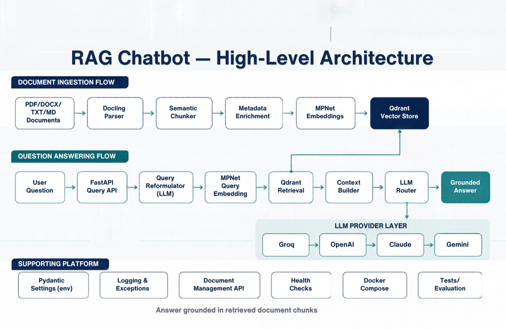
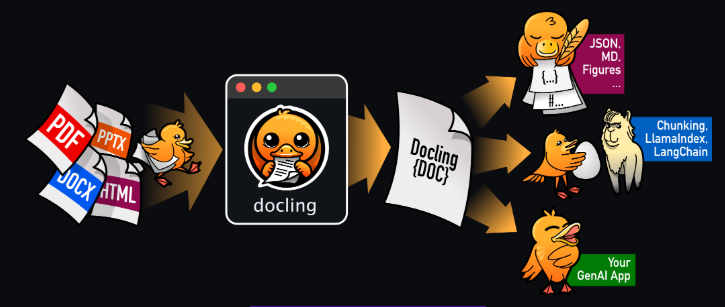

<div align="center">

# 🧠 RAG Knowledge Assistant

**AI-powered knowledge assistant that answers questions from your documents — with source citations and hallucination prevention.**

[](https://python.org)
[](https://fastapi.tiangolo.com)
[](https://qdrant.tech)
[](LICENSE)

</div>

---

## 📌 What is this?

RAG Knowledge Assistant lets you upload any **PDF, TXT, or Markdown** documents and ask questions about them in natural language. It:

- 📄 **Parses** documents using [Docling](https://github.com/DS4SD/docling) → clean Markdown
- 🔪 **Chunks** text semantically using MPNet embedding similarity
- 🔎 **Retrieves** relevant chunks via cosine similarity search in [Qdrant](https://qdrant.tech)
- 🤖 **Answers** grounded in retrieved content using Groq / OpenAI / Claude / Gemini
- 📎 **Cites** source document names and excerpts for every answer
- 🚫 **Says "I don't know"** when your documents don't contain the answer

---

## 🏗️ Architecture

```
 ┌─────────────────────────────────────────────────────────────────────┐
 │                        RAG PIPELINE                                 │
 │                                                                     │
 │  POST /ingest                           POST /query                 │
 │       │                                      │                      │
 │       ▼                                      ▼                      │
 │  Docling Parser                   LLM Query Reformulator            │
 │  (PDF/TXT/MD → Markdown)          (Groq → structured JSON)          │
 │       │                                      │                      │
 │       ▼                                      ▼                      │
 │  Semantic Chunker                 MPNet Embedding (query)           │
 │  (MPNet similarity splits)                   │                      │
 │       │                                      ▼                      │
 │       ▼                             Qdrant Vector Search            │
 │  MPNet Embedder                              │                      │
 │  (768-dim vectors)                           ▼                      │
 │       │                           Context Assembler                 │
 │       ▼                           (confidence threshold)            │
 │  Qdrant Upsert                               │                      │
 │  + Metadata Store              ┌─────────────┴───────────┐         │
 │                                │                         │         │
 │                           Answerable?             Not found        │
 │                                │                         │         │
 │                                ▼                         ▼         │
 │                         LLM Answer Gen          "Not available"    │
 │                         (Groq→OAI→Claude→Gemini)   message        │
 └─────────────────────────────────────────────────────────────────────┘
```

### High-Level Architecture



### Document Parsing with Docling



> [Docling](https://github.com/DS4SD/docling) converts PDF, TXT, and Markdown files into clean, structured Markdown — preserving headings, tables, and layout for accurate chunking and retrieval.

### Tech Stack

| Layer | Technology |
|---|---|
| API Framework | FastAPI + Uvicorn |
| Document Parsing | Docling (PDF/TXT/MD → Markdown) |
| Embeddings | `sentence-transformers/all-mpnet-base-v2` (local, no API cost) |
| Vector Store | Qdrant (Docker) |
| LLM (Primary) | Groq — `openai/gpt-oss-20b` |
| LLM (Fallback 1) | OpenAI — `gpt-4o-mini` |
| LLM (Fallback 2) | Anthropic Claude — `claude-3-haiku` |
| LLM (Fallback 3) | Google Gemini — `gemini-1.5-flash` |
| Validation | Pydantic v2 |
| Testing | pytest + httpx |

---

## 📋 Prerequisites

Before you start, make sure the following are installed on your machine:

| Tool | Version | Install link |
|---|---|---|
| Python | 3.11 or higher | https://python.org/downloads |
| Docker Desktop | Latest | https://docs.docker.com/get-docker |
| Git | Any | https://git-scm.com/downloads |
| curl | Any | Pre-installed on Mac/Linux. Windows: use Git Bash |

> **Windows users:** All commands below work in **PowerShell** or **Git Bash**.

---

## 🚀 Step-by-Step Setup (Zero to Running)

### Step 1 — Clone the Repository

```bash
git clone https://github.com/your-username/RagChatbot.git
cd RagChatbot
```

---

### Step 2 — Create Your Environment File

```bash
# Copy the template
cp .env.example .env
```

Now open `.env` in any text editor and fill in **at minimum** your Groq API key:

```env
GROQ_API_KEY=your_groq_api_key_here
```

> **Get a free Groq API key:** https://console.groq.com/keys  
> The other LLM keys (OpenAI, Anthropic, Gemini) are optional — the system will fall back automatically.

Your `.env` should look like this when done:

```env
APP_ENV=development
APP_HOST=0.0.0.0
APP_PORT=8000

QDRANT_HOST=localhost
QDRANT_PORT=6333
QDRANT_COLLECTION_NAME=rag_knowledge_base

EMBEDDING_MODEL=sentence-transformers/all-mpnet-base-v2
EMBEDDING_DEVICE=cpu

GROQ_API_KEY=gsk_xxxxxxxxxxxxxxxxxxxx   ← required
GROQ_MODEL=llama-3.3-70b-versatile

OPENAI_API_KEY=sk-...                   ← optional
ANTHROPIC_API_KEY=sk-ant-...            ← optional
GOOGLE_API_KEY=AIza...                  ← optional

RETRIEVAL_TOP_K=5
CONFIDENCE_THRESHOLD=0.4
```

---

### Step 3 — Start Qdrant with Docker

Qdrant is the vector database that stores your document embeddings. Run it as a Docker container:

```bash
docker compose -f docker/qdrant/docker-compose.qdrant.yml up -d
```

**Verify Qdrant is running:**

```bash
curl http://localhost:6333/readyz
```

Expected output:
```json
{"title":"qdrant - vector search engine","version":"1.11.3","commit":"..."}
```

> If `curl` is not available on Windows, open http://localhost:6333/readyz in your browser.

---

### Step 4 — Choose how to run the app

You have two options: **Docker (recommended)** or **Local Python**.

---

#### Option A — Run Everything with Docker (Recommended)

This is the simplest approach. Docker handles all Python dependencies automatically.

**Step 4A-1: Create the shared Docker network** (only needed once)

```bash
docker network create qdrant_net
```

> If you already ran Step 3, the network was created automatically. If you see "network already exists", that's fine.

**Step 4A-2: Build and start the app**

```bash
docker compose up --build
```

This will:
1. Build the Docker image (downloads Python packages + MPNet model, takes ~5 min first time)
2. Start the FastAPI server on port 8000

You should see:
```
rag-knowledge-assistant  | INFO     | app.main | Starting RAG Knowledge Assistant (env=development)
rag-knowledge-assistant  | INFO     | app.main | Embedding model ready.
rag-knowledge-assistant  | INFO     | app.main | Qdrant connection verified.
rag-knowledge-assistant  | INFO     | uvicorn  | Application startup complete.
```

**Step 4A-3: Run in background (optional)**

```bash
docker compose up --build -d
```

**To stop:**
```bash
docker compose down
```

---

#### Option B — Run Locally with Python

Use this if you want faster iteration during development.

**Step 4B-1: Create a virtual environment**

```bash
# Create venv
python -m venv .venv

# Activate it
# On macOS/Linux:
source .venv/bin/activate
# On Windows (PowerShell):
.\.venv\Scripts\Activate.ps1
# On Windows (Command Prompt):
.\.venv\Scripts\activate.bat
```

**Step 4B-2: Install dependencies**

```bash
pip install -r requirements.txt
```

> First time: this downloads ~2GB (PyTorch + Sentence-Transformers). Get a coffee ☕

**Step 4B-3: Start the server**

```bash
uvicorn app.main:app --host 0.0.0.0 --port 8000 --reload
```

You should see:
```
INFO  | app.main | Embedding model ready.
INFO  | app.main | Qdrant connection verified.
INFO  | uvicorn  | Application startup complete.
```

> The `--reload` flag restarts the server automatically when you edit code.

---

### Step 5 — Verify the App is Running

Open your browser at http://localhost:8000/docs — you should see the Swagger UI:

Or via curl:
```bash
curl http://localhost:8000/health
```

Expected output:
```json
{"status": "ok", "version": "1.0.0"}
```

Check Qdrant connectivity:
```bash
curl http://localhost:8000/health/ready
```

Expected output:
```json
{"status": "ready", "qdrant": "connected"}
```

---

### Step 6 — Ingest Sample Documents

Upload the included sample documents to build your knowledge base:

```bash
# Ingest the TXT sample
curl -X POST http://localhost:8000/api/v1/ingest \
  -F "file=@sample_documents/sample1.txt"
```

Expected response:
```json
{
  "document_id": "3f2a1b4c-...",
  "filename": "sample1.txt",
  "file_type": "txt",
  "total_chunks": 8,
  "collection": "rag_knowledge_base",
  "message": "Document ingested successfully"
}
```

```bash
# Ingest the Markdown sample
curl -X POST http://localhost:8000/api/v1/ingest \
  -F "file=@sample_documents/sample2.md"
```

```bash
# Ingest your own PDF
curl -X POST http://localhost:8000/api/v1/ingest \
  -F "file=@/path/to/your/document.pdf"
```

---

### Step 7 — Ask Questions

**Answerable question:**

```bash
curl -X POST http://localhost:8000/api/v1/query \
  -H "Content-Type: application/json" \
  -d '{"question": "What is Python primarily used for?"}'
```

Expected response:
```json
{
  "question": "What is Python primarily used for?",
  "answer": "According to sample1.txt, Python is primarily used for web development (Django, FastAPI, Flask), data science and machine learning, automation and scripting, scientific computing, and artificial intelligence.",
  "is_answerable": true,
  "evidence": [
    {
      "document_id": "3f2a1b4c-...",
      "filename": "sample1.txt",
      "chunk_index": 2,
      "score": 0.924,
      "excerpt": "Python is primarily used for: Web development...",
      "page_number": null
    }
  ],
  "reformulated_query": "What are the primary use cases and applications of Python programming language?",
  "provider_used": "groq"
}
```

**Unanswerable question (not in documents):**

```bash
curl -X POST http://localhost:8000/api/v1/query \
  -H "Content-Type: application/json" \
  -d '{"question": "Who won the FIFA World Cup in 2026?"}'
```

Expected response:
```json
{
  "question": "Who won the FIFA World Cup in 2026?",
  "answer": "The information requested is not available in the provided documents.",
  "is_answerable": false,
  "evidence": [],
  "reformulated_query": "FIFA World Cup 2026 winner champion",
  "provider_used": "none"
}
```

**Multi-chunk question:**

```bash
curl -X POST http://localhost:8000/api/v1/query \
  -H "Content-Type: application/json" \
  -d '{"question": "Compare the benefits and limitations of RAG versus fine-tuning."}'
```

---

### Step 8 — Manage Documents

**List all ingested documents:**

```bash
curl http://localhost:8000/api/v1/documents
```

**List all collections:**

```bash
curl http://localhost:8000/api/v1/documents/collections
```

**Delete a document by ID:**

```bash
curl -X DELETE http://localhost:8000/api/v1/documents/3f2a1b4c-...
```

---

## 🧪 Running Tests

### Unit + Integration Tests (no live services needed)

These tests mock Qdrant and LLM providers — run them anytime:

```bash
# Activate venv first (if running locally)
pytest tests/unit tests/integration -v
```

Expected output:
```
tests/unit/test_parser.py::TestParseDocument::test_txt_returns_markdown PASSED
tests/unit/test_chunker.py::TestSemanticChunk::test_multiple_sentences_produce_chunks PASSED
tests/unit/test_embeddings.py::TestEmbedTexts::test_returns_list_of_vectors PASSED
tests/unit/test_retrieval.py::TestAssembleContext::test_high_score_returns_answerable PASSED
tests/integration/test_ingest_api.py::TestIngestEndpoint::test_ingest_txt_returns_201 PASSED
tests/integration/test_query_api.py::TestQueryEndpoint::test_answerable_question_returns_200 PASSED
...
========================= 20 passed in 4.32s =========================
```

---

### Functional Evaluation (live API — flag-based)

Runs 11 questions against the live API and checks `is_answerable` flags:

```bash
pytest tests/evaluation/test_questions.py -v
```

11 questions tested:
- 5 single-chunk answerable
- 2 multi-chunk answerable
- 4 unanswerable (must return `is_answerable: false`)

---

### RAGAS Evaluation (scored metrics)

[RAGAS](https://docs.ragas.io) measures answer quality with **4 LLM-judged metrics**. The script calls the live API, collects answers + retrieved contexts, and scores them automatically.

#### How RAGAS Plugs Into This Pipeline

```
eval_dataset.json          Live /query API            RAGAS Scorer
(questions +   ──────────► returns:        ──────────► LLM Judge (OpenAI)
 ground truths)            ┌─ answer                        │
                           └─ evidence[].excerpt ───────────┘
                                                            │
                                                      Score outputs:
                                                      faithfulness       (0–1)
                                                      answer_relevancy   (0–1)
                                                      context_precision  (0–1)
                                                      context_recall     (0–1)
                                                            │
                                                   tests/evaluation/eval_report.md
```

#### RAGAS Metrics Explained

| Metric | What It Measures | Calculation |
|---|---|---|
| **Faithfulness** | No hallucination — answer claims are in the context | LLM decomposes answer into atomic claims, verifies each against retrieved excerpts. Score = verified ÷ total |
| **Answer Relevancy** | Answer actually addresses the question | LLM generates N synthetic questions from the answer, cosine similarity to original question |
| **Context Precision** | Retrieved chunks are relevant (signal-to-noise) | Ranks each chunk by relevance; penalises irrelevant chunks ranked above relevant ones |
| **Context Recall** | Retrieved context covers the full ground truth | LLM checks what fraction of ground truth statements are attributable to retrieved context |

All metrics score **0.0 → 1.0**. Our pipeline targets **≥ 0.70 on all metrics**.

#### Run RAGAS Evaluation

**Prerequisites:**
- API running (`uvicorn app.main:app --port 8000`)
- Sample documents ingested (Step 6 above)
- `OPENAI_API_KEY` set in `.env` — RAGAS uses OpenAI as its internal LLM judge

```bash
# Run the full RAGAS evaluation
python tests/evaluation/ragas_eval.py
```

#### Expected Terminal Output

```
✅ Loaded 12 questions from tests/evaluation/eval_dataset.json

📡 Calling API at http://localhost:8000 for 12 questions...

  [01/12] What is Python primarily used for?
         → is_answerable=True, contexts=3, provider=groq
  [02/12] What does RAG stand for in AI?
         → is_answerable=True, contexts=2, provider=groq
  ...
  [11/12] Who won the FIFA World Cup in 2026?
         → is_answerable=False, contexts=0, provider=none
  [12/12] What is the GDP of Iceland?
         → is_answerable=False, contexts=0, provider=none

✅ Collected 10 answerable, 2 unanswerable responses

🔬 Running RAGAS evaluation (this may take a minute)...

============================================================
           RAGAS EVALUATION REPORT
============================================================

📋 Dataset Summary
   Total questions      : 12
   Answerable questions : 10
   Unanswerable         : 2

📊 RAGAS Metrics (Answerable Questions)
   Faithfulness         : 0.9200  ✅
   Answer Relevancy     : 0.8750  ✅
   Context Precision    : 0.8400  ✅
   Context Recall       : 0.8100  ✅
   ─────────────────────────────────
   Overall RAGAS Score  : 0.8613  ✅ PASS

🚫 Unanswerable Question Handling
   Correct refusals     : 2/2
   Refusal rate         : 1.0000  ✅

============================================================

📄 Report saved to: tests/evaluation/eval_report.md
```

#### Custom Options

```bash
# Different API URL
python tests/evaluation/ragas_eval.py --api-url http://my-server:8000

# Custom output path
python tests/evaluation/ragas_eval.py --output results/report.md

# Custom question dataset
python tests/evaluation/ragas_eval.py --dataset my_questions.json
```

#### Evaluation Dataset Format

Edit [`tests/evaluation/eval_dataset.json`](tests/evaluation/eval_dataset.json) to add your own questions:

```json
[
  {
    "question": "What is the refund policy?",
    "ground_truth": "The refund policy allows returns within 30 days."
  },
  {
    "question": "What is the CEO salary?",
    "ground_truth": "NOT_IN_DOCUMENTS"
  }
]
```

> Set `ground_truth` to `"NOT_IN_DOCUMENTS"` for questions that should be refused with `is_answerable: false`.

---


## 📡 API Reference

| Method | Endpoint | Description |
|--------|----------|-------------|
| `POST` | `/api/v1/ingest` | Upload and index a document (PDF/TXT/MD) |
| `POST` | `/api/v1/query` | Ask a question, get grounded answer + evidence |
| `GET` | `/api/v1/documents` | List all indexed documents |
| `GET` | `/api/v1/documents/collections` | List all Qdrant collections |
| `DELETE` | `/api/v1/documents/{id}` | Delete a document by ID |
| `GET` | `/health` | Liveness probe — returns `{"status": "ok"}` |
| `GET` | `/health/ready` | Readiness probe — checks Qdrant connectivity |
| `GET` | `/docs` | Interactive Swagger UI |
| `GET` | `/redoc` | ReDoc API documentation |

### POST `/api/v1/ingest`

| Field | Type | Description |
|---|---|---|
| `file` | `File` (multipart) | PDF, TXT, or MD file |
| `collection` | `string` (optional) | Override default collection name |

### POST `/api/v1/query`

```json
{
  "question": "string (3–2000 chars, required)",
  "top_k": "integer (1–20, default: 5)",
  "collection": "string (optional, overrides default)"
}
```

---

## 🔧 Configuration Reference

All configuration is via environment variables in `.env`. See [`.env.example`](.env.example) for descriptions.

| Variable | Default | Description |
|---|---|---|
| `QDRANT_HOST` | `localhost` | Qdrant hostname |
| `QDRANT_PORT` | `6333` | Qdrant port |
| `QDRANT_COLLECTION_NAME` | `rag_knowledge_base` | Default collection |
| `EMBEDDING_MODEL` | `sentence-transformers/all-mpnet-base-v2` | HuggingFace model ID |
| `EMBEDDING_DEVICE` | `cpu` | `cpu`, `cuda`, or `mps` |
| `GROQ_API_KEY` | — | **Required** for default LLM |
| `GROQ_MODEL` | `llama-3.3-70b-versatile` | Groq model name |
| `RETRIEVAL_TOP_K` | `5` | Chunks to retrieve per query |
| `CONFIDENCE_THRESHOLD` | `0.4` | Min score to be "answerable" |
| `CHUNK_MAX_TOKENS` | `512` | Max tokens per chunk |
| `SEMANTIC_SIMILARITY_THRESHOLD` | `0.75` | Similarity below this starts new chunk |

---

## 🗂️ Project Structure

```
RagChatbot/
├── app/
│   ├── main.py                     # FastAPI app (entry point)
│   ├── config.py                   # All settings via .env
│   ├── dependencies.py             # FastAPI DI helpers
│   ├── api/
│   │   ├── middleware.py           # CORS + request logging
│   │   └── routes/
│   │       ├── ingest.py           # POST /ingest
│   │       ├── query.py            # POST /query
│   │       └── documents.py        # GET/DELETE /documents
│   ├── ingestion/
│   │   ├── parser.py               # Docling PDF/TXT/MD → Markdown
│   │   ├── chunker.py              # Semantic chunking
│   │   └── metadata.py             # Per-chunk metadata builder
│   ├── embeddings/
│   │   └── mpnet.py                # MPNet singleton embedder
│   ├── vectorstore/
│   │   ├── client.py               # Qdrant client factory
│   │   ├── collections.py          # Collection CRUD
│   │   └── indexer.py              # Upsert + delete by document
│   ├── retrieval/
│   │   ├── reformulator.py         # LLM query reformulation
│   │   ├── searcher.py             # Vector search
│   │   └── context.py              # Context assembly + confidence gate
│   ├── llm/
│   │   ├── router.py               # Groq→OAI→Claude→Gemini fallback
│   │   ├── prompts.py              # System + user prompt templates
│   │   └── providers/              # groq.py, openai.py, claude.py, gemini.py
│   ├── schemas/
│   │   ├── ingest.py               # IngestRequest/Response
│   │   ├── query.py                # QueryRequest/Response, EvidenceItem
│   │   └── reformulation.py        # ReformulatedQuery (Pydantic)
│   └── utils/
│       ├── logger.py               # Structured logging
│       └── exceptions.py           # Custom exception hierarchy
├── tests/
│   ├── conftest.py                 # Shared fixtures
│   ├── unit/                       # test_parser, test_chunker, test_embeddings, test_retrieval
│   ├── integration/                # test_ingest_api, test_query_api
│   └── evaluation/                 # 11 evaluation questions
├── sample_documents/               # sample1.txt, sample2.md
├── docker/
│   └── qdrant/
│       └── docker-compose.qdrant.yml   # Standalone Qdrant
├── .env.example                    # Environment variable template
├── .gitignore
├── Dockerfile                      # App container
├── docker-compose.yml              # App + connects to existing Qdrant
├── requirements.txt
├── pyproject.toml
└── README.md
```

---

## 🏛️ Architecture Decisions

| Decision | Choice | Rationale |
|---|---|---|
| **Document parser** | Docling | Handles PDF/TXT/MD → clean Markdown; reliable table and heading extraction vs raw PyPDF2 |
| **Embedding model** | MPNet (local) | Zero API cost per embedding; 768-dim vectors; strong semantic quality; no cold start after first load |
| **Chunking strategy** | Semantic (embedding similarity) | Preserves natural topic boundaries vs fixed-size character/token splits that cut mid-sentence |
| **Vector store** | Qdrant | Open-source, Rust-based, fast, supports payload filtering; runs in Docker with persistent volumes |
| **Query reformulation** | LLM + Pydantic schema | Structured JSON output prevents parse errors; extracts search terms and intent reliably |
| **LLM provider** | Router pattern (Groq→OAI→Claude→Gemini) | No single point of failure; Groq chosen first for speed (~100 tokens/s); seamless fallback |
| **Confidence gate** | Score threshold (default 0.4) | Two-layer hallucination prevention: vector score filter + system prompt instruction |
| **"Don't know" handling** | Prompt instruction + confidence gate | Tells the LLM explicitly not to answer; confidence gate prevents low-relevance chunks from ever reaching the LLM |

---

## ⚠️ Known Limitations

1. **PDF quality** — Complex multi-column PDFs or scanned images may not parse perfectly. Docling works best with digital (text-layer) PDFs.
2. **MPNet context window** — 384 token max per sentence. Very long sentences are embedded truncated.
3. **Dense-only retrieval** — No BM25 hybrid search by default. Exact keyword matches may be missed in edge cases.
4. **First-request latency** — MPNet model loads on startup (~5–10s). Pre-warming is done at lifespan but first request may still be slightly slow in Docker.
5. **Groq rate limits** — Free-tier Groq has RPM/TPM limits. The LLM router automatically falls back to OpenAI when Groq rate-limits.
6. **Evaluation metrics** — Evaluation tests use heuristic pass/fail (`is_answerable` flag). Production-grade evaluation would use RAGAS or DeepEval metrics.

---

## 🤝 Contributing

1. Fork the repository
2. Create a feature branch: `git checkout -b feature/your-feature`
3. Make your changes and run tests: `pytest tests/unit tests/integration -v`
4. Commit: `git commit -m "feat: your feature description"`
5. Push and open a Pull Request

---

## 📄 License

MIT License — see [LICENSE](LICENSE) for details.
